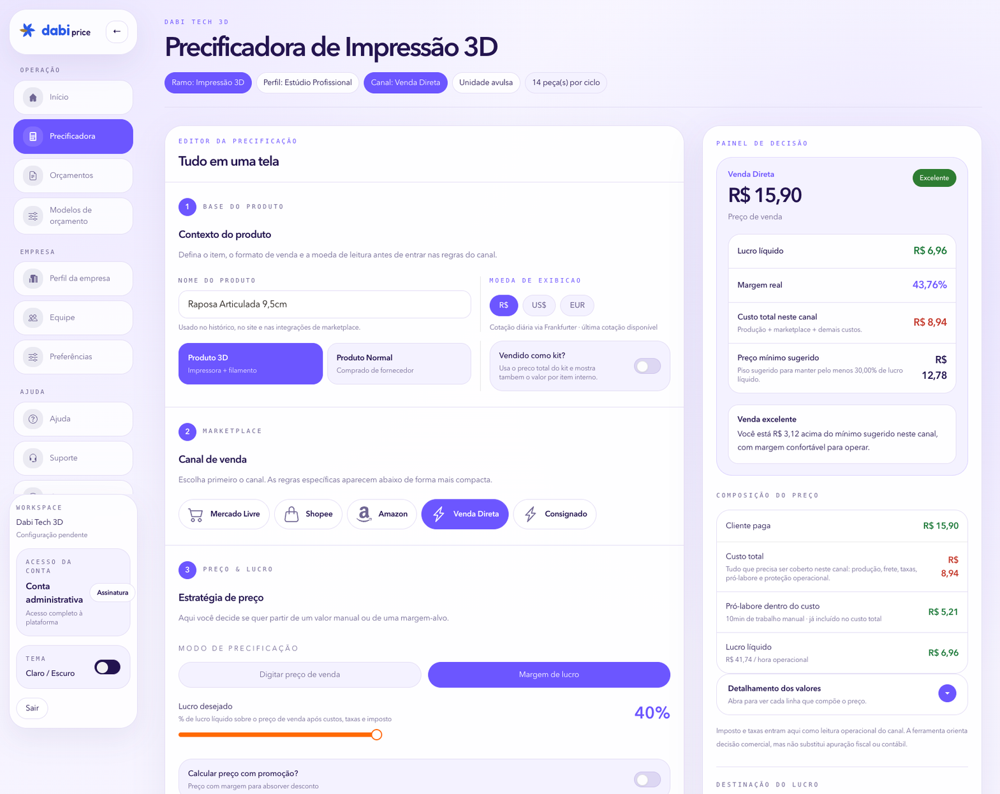
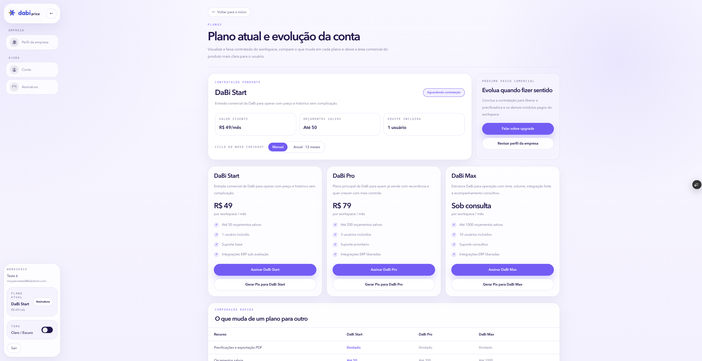
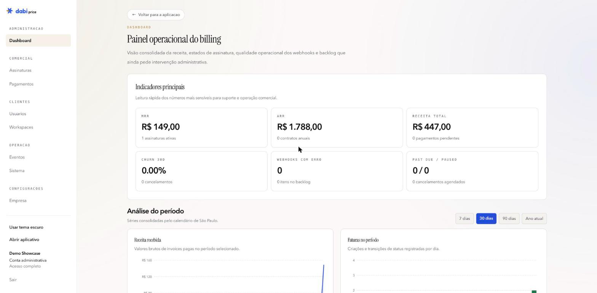
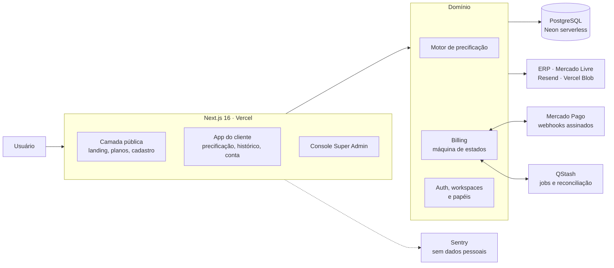

# DaBi Price

**SaaS de precificação para pequenos negócios brasileiros** (impressão 3D, confeitaria, revenda e marketplaces).

A DaBi Price mostra ao empreendedor a diferença entre o **custo real** de um produto, o **preço saudável** e o preço que cada **canal de venda** (loja própria, Mercado Livre, revenda) exige para manter a margem. É um produto da [DaBi Tech](https://dabitech.com.br), desenvolvido por mim de ponta a ponta: produto, arquitetura, código, testes, infraestrutura e operação.

> 🔒 **O código-fonte é privado** por ser um produto comercial. Este repositório documenta a arquitetura, as decisões técnicas e o processo de desenvolvimento. Posso liberar acesso de leitura ou apresentar o código em uma conversa técnica. É só me chamar pelo [LinkedIn](https://www.linkedin.com/in/moysesemanuel/).

---

## Telas

| Precificação | Planos e assinatura | Console Super Admin |
|---|---|---|
|  |  |  |

---

## O que o produto faz

- **Motor de precificação** por segmento (3D, confeitaria, revenda), com leitura de margem por canal de venda
- **Multi-tenant por workspace**, com membros, papéis (owner, manager, operator, finance) e isolamento de dados
- **Assinaturas** com planos Start, Pro e Max, ciclos mensal e anual, Pix e cartão recorrente via Mercado Pago
- **Upgrade, downgrade e mudança de ciclo** com proração, tolerância e expiração
- **Console de Super Admin** para usuários, workspaces, pagamentos, eventos e auditoria, sem editor genérico de banco
- **Orçamento para o cliente final**, com documento pronto para imprimir ou exportar em PDF
- **Integrações** com ERP e Mercado Livre (OAuth por workspace), upload de imagens e e-mail transacional
- Autenticação por sessão com cookie `httpOnly`, recuperação de acesso, consentimento legal (LGPD) e rate limit

---

## Arquitetura

O motor de cálculo é isolado da interface e da autenticação, e o **workspace** é a unidade de operação do cliente: o usuário pertence à plataforma, e as permissões pertencem à relação usuário + workspace. Detalhes em [docs/arquitetura.md](docs/arquitetura.md).

---

## Destaques de engenharia

**Billing resistente a concorrência.** Webhook, reconciliação e expiração podem disputar a mesma fatura ao mesmo tempo. Cada transição crítica é decidida por um único statement atômico (compare-and-set), com claims duráveis com lease para retomar efeitos interrompidos, deduplicação de eventos e idempotency keys nas chamadas ao provedor. Dez entregas simultâneas do mesmo webhook geram um único processamento. A decisão está registrada em um ADR: [docs/adr-001-concorrencia-billing.md](docs/adr-001-concorrencia-billing.md).

**Observabilidade sem vazar dados.** Sentry instrumentado nos runtimes de browser, Node e Edge, com ambientes separados (produção, preview, homologação). Antes do envio, um filtro remove dados de requisição e de usuário e mascara valores sensíveis. Veja [docs/observabilidade.md](docs/observabilidade.md).

**Qualidade automatizada.** 61 suítes de testes unitários e 9 de integração com Postgres real, cobrindo precificação, billing, concorrência, controle de acesso e observabilidade. Toda pull request passa por lint, typecheck, testes e build no GitHub Actions. Veja [docs/estrategia-de-testes.md](docs/estrategia-de-testes.md).

**Desenvolvimento orientado a especificação, com IA.** Escopo congelado por ciclo, plano de 24 fases com critérios de aceite, ADRs antes de mudanças estruturais e agentes de IA trabalhando sobre essas especificações. Veja [docs/processo-de-desenvolvimento.md](docs/processo-de-desenvolvimento.md).

---

## Stack

`Next.js 16` `React 19` `TypeScript` `Tailwind CSS 4` `PostgreSQL (Neon)` `Mercado Pago` `Upstash QStash` `Resend` `Vercel Blob` `Sentry` `GitHub Actions` `Vercel`

---

## Autor

**Moyses Emanuel**, Desenvolvedor Full Stack · Curitiba, PR
[LinkedIn](https://www.linkedin.com/in/moysesemanuel/) · [GitHub](https://github.com/moysesemanuel) · [mecs.cwb@gmail.com](mailto:mecs.cwb@gmail.com)
